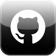

# GitHub Legacy


[](https://github.com/kitalev/GitHub-Legacy/releases/latest)
[](LICENSE)
[](https://t.me/kitalev)

**English** · [Русский](README.ru.md)

---

A lightweight native GitHub client for iOS 4 and newer: repositories, READMEs, issues, pull requests, commits, and releases — without Safari, and without the official app, which no longer runs on older versions.

## Features

- Browse repositories, explore trending projects, and search by name, topic, or user
- View rendered READMEs, issues, pull requests, and full commit history
- Create issues with photos and files attached
- Search inside code files
- Recently opened repositories on the Search screen
- Download release assets directly on-device (`.deb`, `.ipa`, source archives, etc.)
- Star repositories and follow users, with a dedicated tab for starred-repo release news
- Sign in with username and password, a Google account, GitHub device login, or a token
- Light and dark themes, with an in-app English/Russian language switch

## Supported devices

| Architecture | iOS | Devices |
|---|---|---|
| `armv6` (32-bit) | 4.0–4.2.1 | iPhone 3G · iPod touch 2nd gen |
| `armv7` (32-bit) | 4.0–10.x | iPhone 3GS, 4, 4S, 5, 5c · iPod touch 3rd, 4th and 5th gen · iPad 1, 2, 3, 4, iPad mini |
| `arm64` (64-bit) | 7.0 and newer | iPhone 5s and every later iPhone · iPod touch 6th and 7th gen · iPad Air and later, iPad mini 2 and later, every iPad Pro |

Which package to install:

| Package | Jailbreak type | Typical iOS | Contains |
|---|---|---|---|
| `GitHubLegacy_*_rootful_iOS4-14.deb` | rootful (Cydia, unc0ver, checkra1n, Taurine, palera1n rootful) | 4.0–14.x (up to iPhone 12), also rootful 15–16 on A8–A11 | `armv6` + `armv7` + `arm64`, Safari tweak also `arm64e` |
| `GitHubLegacy_*_rootless_iOS15+.deb` | rootless (Dopamine, palera1n rootless) | 15.0 and newer | `arm64`, Safari tweak also `arm64e` |
| `GitHubLegacy_*.ipa` | none (TrollStore, AltStore, Sideloadly, Plume Impactor) | any supported version | `armv6` + `armv7` + `arm64`, no Safari tweak |

Developed on an **iPhone 4S running iOS 5.1.1**, and also tested on iOS 4 and on an iPhone 7 with iOS 13.7. Newer iOS versions should work but haven't been fully tested yet. The Safari redirect tweak's `arm64e` slice uses the new arm64e ABI, so on iPhone XS and newer it loads on iOS 14+; on iOS 12–13 on those devices the app works, but the redirect from Safari doesn't.

## Install

### From the repository (recommended)

Add the repository in Cydia, Sileo, Zebra, or Installer:

```
https://kitalev.github.io/repo/
```

- **Cydia:** Sources → Edit → Add
- **Sileo / Zebra:** Sources → `+`

Then search for **GitHub Legacy** and install it. Updates arrive through the package manager like any other package.

### From the latest release (.deb)

1. Download the `.deb` for your jailbreak type from the [latest release](https://github.com/kitalev/GitHub-Legacy/releases/latest): `rootful` or `rootless` (see the table above).
2. Put the `.deb` file on your device (for example: `/var/mobile/`).
3. In iFile or Filza, find the `.deb`, tap it, and press `Install`.

Or via terminal:

```bash
dpkg -i GitHubLegacy_2.0_rootful_iOS4-14.deb    # rootful
dpkg -i GitHubLegacy_2.0_rootless_iOS15+.deb    # rootless
```

### From the latest release (.ipa)

Download the `.ipa` from the [latest release](https://github.com/kitalev/GitHub-Legacy/releases/latest) and install it with TrollStore, AltStore, Sideloadly, Plume Impactor, or Filza with AppSync Unified. No jailbreak required for sideloading tools.

- On iOS 16 and newer, sideloaded apps need Developer Mode: Settings → Privacy & Security → Developer Mode.
- The `.ipa` uses its own bundle ID (`com.githublegacy.ipa`), so it can be installed next to the `.deb` version. Each keeps its own sign-in.

> **Note:** on some iOS 10.x devices, Filza can crash while installing the `.ipa`. If that happens, install the `.deb` instead (see above), or use another sideloading tool for the `.ipa`.

## Build

Requires **Theos**, with `THEOS` pointing to its install path:

```bash
export THEOS=/opt/theos
```

You'll also need:

- a Clang toolchain targeting iOS (e.g. `$THEOS/toolchain/linux/iphone/bin`);
- `iPhoneOS9.3.sdk` under `$THEOS/sdks/` — the Makefile builds against it and derives an `armv6`-capable copy from it automatically;
- `plistutil` (`sudo apt install libplist-utils`) to convert `Info.plist` to binary and set the `.ipa` bundle ID.

`MinimumOSVersion` in `Info.plist` restricts the app to iOS 4+ at runtime.

```bash
# rootful .deb (iphoneos-arm: armv6 + armv7 + arm64)
make clean
make package FINALPACKAGE=1

# rootless .deb (iphoneos-arm64, installs under /var/jb)
make clean
make package FINALPACKAGE=1 THEOS_PACKAGE_SCHEME=rootless

# .ipa (regular app, sideloadable) — written to GitHubLegacy.ipa in the project root
make clean
make ipa FINALPACKAGE=1 PACKAGE_FORMAT=ipa
```

Built `.deb` packages land in `packages/`.

## Uninstall

### Via Cydia, Sileo, or Zebra

Just remove it like any other package.

### Via terminal

```bash
dpkg -r com.githublegacy.app
```

## License

[MIT](LICENSE)
